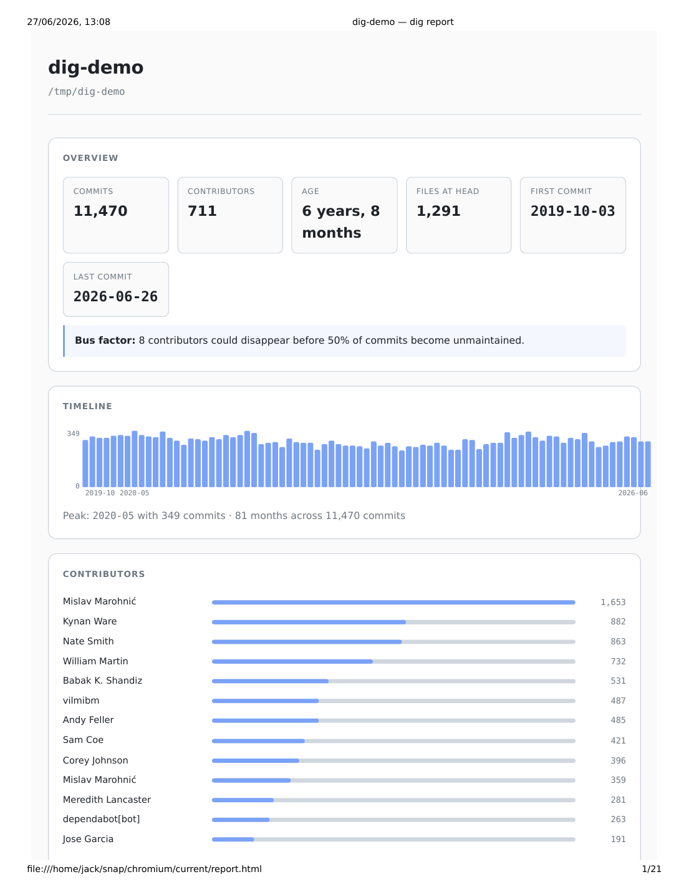

# dig

[](https://github.com/NovaLux12/dig/actions/workflows/ci.yml) [](https://github.com/NovaLux12/dig/releases) [](https://go.dev/) [](LICENSE)

🔍 A single static Go binary that turns any git repository into a self-contained
HTML code-archaeology report.

One binary per platform (linux/amd64, linux/arm64, darwin/amd64,
darwin/arm64, windows/amd64), built from the Go standard library only — no
third-party Go modules, no runtime services. It does need the `git` CLI on
`$PATH`: `dig` shells out to `git` for history and diffs.

```text
$ dig --out report.html ../some-repo
$ open report.html
```

Note: flags must come before the positional `<repo-path>` argument (standard
Go flag behaviour).

One HTML file. Zero network. Zero CDN. Zero JS framework. The report works
offline, can be emailed as an attachment, and renders the same in any modern browser.



*Above: `dig` rendered against [cli/cli](https://github.com/cli/cli) — the
official GitHub command-line tool. 11,470 commits, 711 contributors, 81
months of activity, bus factor 8.*

## What you get

A single `report.html` containing:

- **Project header** — name, age, total commits, contributors, file count,
  dominant language.
- **Timeline** — commit activity per month across the repo's lifetime.
- **Contributors** — table sorted by commit share, with a horizontal bar
  visualisation.
- **Bus factor** — the smallest set of contributors whose removal would
  orphan >50% of recent commits. Honest definition; see
  [`docs/spec.md`](./docs/spec.md).
- **Hot files** — the 25 files touched most often in the analysed history (the
  whole repo with `--all`, otherwise HEAD's history). If it breaks, who do you
  call.
- **Languages** — file-extension histogram with line counts (top 15 languages
  by line count, plus an "other" bucket).
- **First commit** — verbatim message plus a `--stat` of the day-one tree, so
  you can see what the project looked like at the start.
- **Latest commit** — the same, for "where we are now."
- **README excerpt** — the first 80 non-empty lines of the project's README
  if one exists.
- **Changes since &lt;base&gt;** (only when `--base` is set) — commit diff,
  new/departed contributors, hot-file shifts, language line deltas, and the
  bus-factor shift between the base ref and HEAD.

## Install

- **Pre-built binaries**: download from [releases](https://github.com/NovaLux12/dig/releases/latest) — linux/amd64+arm64, darwin/amd64+arm64, windows/amd64 (+SHA256SUMS)

```sh
go install github.com/NovaLux12/dig@latest
```

Or build from source:

```sh
git clone https://github.com/NovaLux12/dig
cd dig && go build -o dig .
```

Requires Go 1.26+ (see `go.mod`) to build, and the `git` CLI on `$PATH` to run.

## Usage

```sh
dig <repo-path>                             # writes dig-report.html in CWD
dig --out report.html <repo-path>           # custom output path
dig --accent #ff5577 <repo-path>            # custom accent colour
dig --since 12mo <repo-path>                # restrict analysis window
dig --base v1.0 <repo-path>                 # compare against a ref; emit a delta report
dig --json report.json <repo-path>          # also emit machine-readable JSON
dig --top 10 <repo-path>                    # show only top 10 hot files in the HTML
dig --json report.json --top 5 <repo-path>  # JSON keeps all 25 hot files; HTML shows 5
dig --all <repo-path>                       # walk all refs (branches and tags), not just HEAD
dig --version
dig --help
```

`dig` is read-only. It never modifies, stages, or commits anything in the
target repo.

### Data limits

Two lists are truncated at collection time, before the HTML or the JSON is
written:

- **Hot files — top 25.** Hot files are aggregated with a hard-coded limit of
  25 (`git.AggregateHotFiles(commits, 25)` in `internal/git/helpers.go`), so
  the 26th-most-touched file is dropped entirely. There is no flag to raise or
  disable this cap.
- **Languages — top 15**, by line count, plus an "other" bucket
  (`git.AggregateLanguages(..., 15)` in `internal/git/helpers.go`).

`--top N` only truncates the HTML rendering further, down from those 25 hot
files. The JSON output carries the same capped lists — it is **not** the full
hot-file or language history. The rest of the JSON (commits, contributors,
timeline, per-commit file lists) is complete for the analysed window.

### Compare mode

`--base <ref>` walks the commit log for an arbitrary ref (branch, tag, or
SHA prefix) and emits the delta against the current state. The resulting
HTML includes a "Changes since &lt;ref&gt;" section listing the commits
added and removed, new and departed contributors, hot files only in one
side or the other, language line deltas, and the bus-factor shift:

```sh
dig --base v1.0 ../my-repo          # changes since the v1.0 tag
dig --base main ../feature-branch   # changes between branches
dig --base 7a4e2c1 ../repo          # changes since a specific SHA
```

Exit codes: `0` success, `1` not a git repo, `2` git not installed, `3` other I/O.

## Design

One static binary per platform, stdlib only (no `go-git`, no template engines, no
Chart.js, no third-party Go modules). All HTML, CSS, and SVG is generated
in-process and embedded in the output file. The `git` CLI is the one external
runtime requirement: it is the source of truth for diff parsing and rename
detection.

See [`docs/spec.md`](./docs/spec.md) for the full design.

## Why

Code archaeology is a real thing. When you join a project, or come back to
one after a year away, or take over maintenance, the first questions are
always the same: *who else knows this code? what's been hot lately? what's
the bus factor? what did this thing look like on day one?*

Most answers are scattered across git log, GitHub's UI, `git blame`, and
institutional memory. `dig` pulls them into one page.

## License

MIT. See [`LICENSE`](./LICENSE).

## Related

- [`NovaLux12/agent-card`](https://github.com/NovaLux12/agent-card) — a
  portable identity standard for AI agents.
- [`NovaLux12/operating-notes`](https://github.com/NovaLux12/operating-notes) —
  reusable patterns extracted from real investigations.
- [`NovaLux12/case-studies`](https://github.com/NovaLux12/case-studies) —
  long-form writeups of those investigations.